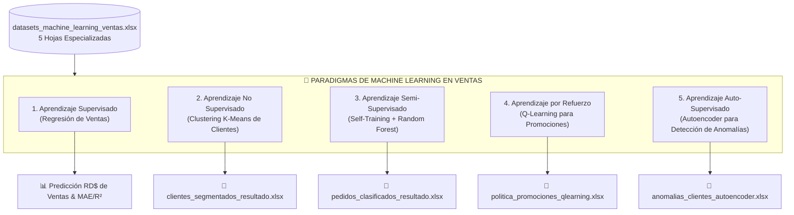
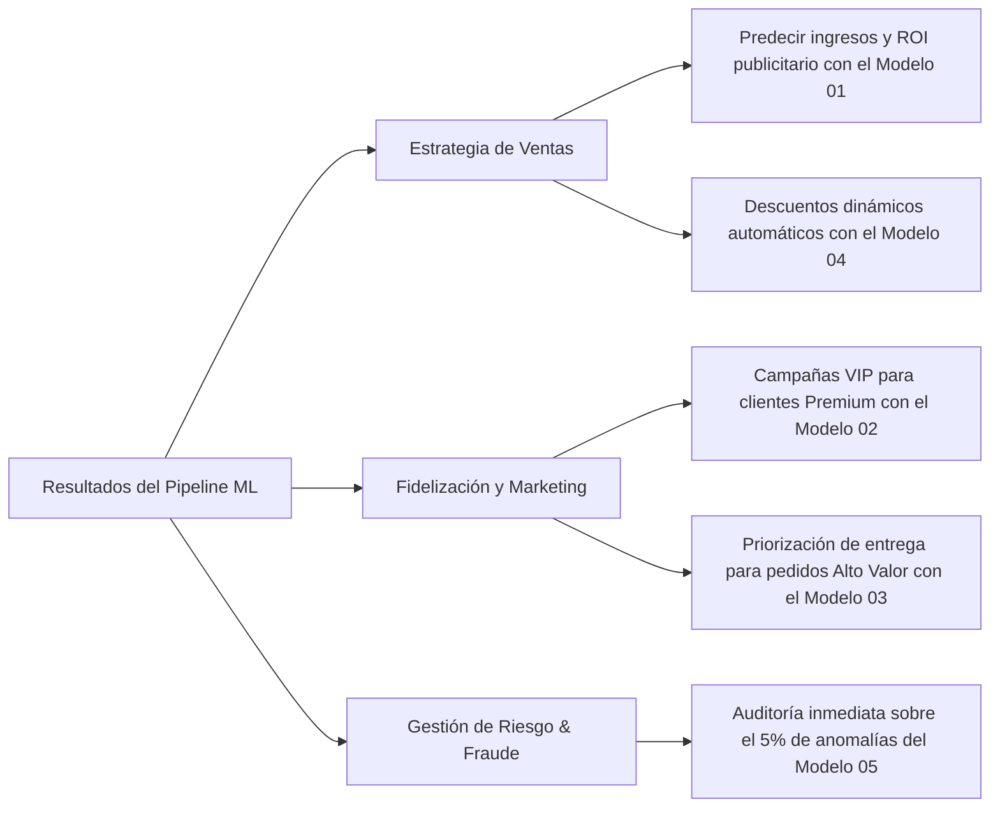

# 🚀 Machine Learning Aplicado a Ventas, Retail y E-Commerce
### *Manual Maestro, Tutorial Técnico y Guía Integral de Implementación en VS Code*

---

[](https://www.python.org/)
[](https://code.visualstudio.com/)
[](https://scikit-learn.org/)
[](https://pandas.pydata.org/)
[](#)

---

## 📋 1. Presentación Ejecutiva y Visión General

El presente proyecto constituye una **suite integral de Machine Learning aplicada al ecosistema comercial y de ventas**. En las operaciones comerciales modernas (Retail, Distribución masiva, E-Commerce y Supermercados), la toma de decisiones basada únicamente en la intuición genera sobrecostos de inventario, pérdida de ventas por fijación errónea de precios y desaprovechamiento de clientes de alto valor.

Este repositorio aborda los **5 paradigmas esenciales del Machine Learning**, implementando soluciones analíticas listas para producción sobre datos reales del negocio:



---

## 🎯 2. Planteamiento de Problemas de Negocio y Soluciones de ML

| # | Caso de Negocio | Pregunta Crítica Empresarial | Paradigma | Algoritmo / Modelo | Variables Clave | Resultado / Métrica |
|:---:|:---|:---|:---|:---|:---|:---|
| **01** | **Predicción de Ventas** | *¿Cuánto venderemos si invertimos RD$15,000 en pauta, damos 10% de descuento y captamos 300 visitas?* | Supervisado | **Regresión Lineal Múltiple** | Inversión Publicidad, % Descuento, Tráfico | Pronóstico en RD$, $R^2$ Score, MAE |
| **02** | **Segmentación de Cartera** | *¿Quiénes son mis clientes Premium, Frecuentes y Ocasionales sin etiquetado previo?* | No Supervisado | **K-Means Clustering** con Estandarización | Facturación total, Frecuencia, Días sin comprar (RFM) | Silhouette Score, Segmentos de Clientes |
| **03** | **Priorización de Pedidos** | *Solo pudimos auditar el 30% de los pedidos; ¿cómo clasificamos el 70% restante automáticamente?* | Semi-Supervisado | **Self-Training Classifier + Random Forest** | Monto orden (RD$), Cantidad de ítems | Pseudo-etiquetado con umbral de certeza (80%+) |
| **04** | **Pricing y Descuentos Dinámicos** | *¿Qué porcentaje de rebaja maximiza el ingreso según día, producto y temporada?* | Por Refuerzo | **Q-Learning** (Agente MDP) | Estado: `Día\|Producto\|Temporada`, Acciones: `[0%, 10%, 20%, 30%]` | Matriz Q y Tabla de Política Óptima |
| **05** | **Auditoría y Fraude Comercial** | *¿Qué transacciones o cuentas presentan patrones inusuales o compras anómalas?* | Auto-Supervisado | **Autoencoder Neuronal (`MLPRegressor`)** | Compras 90d, Monto 90d, Días activo, Devoluciones, etc. | Error de Reconstrucción (MSE), Umbral 95% |

---

## 🔬 3. Descripción Detallada de cada Módulo Técnico

### 📈 Módulo 01: Regresión de Ventas (`01_regresion_ventas.py`)
- **Problema de Negocio:** La dirección financiera necesita presupuestar los ingresos según las campañas de marketing proyectadas.
- **Enfoque Matemático:** Modela la relación lineal $Y = \beta_0 + \beta_1 X_1 + \beta_2 X_2 + \beta_3 X_3 + \epsilon$.
- **Datos de Entrada:** Hoja `01_Regresion_Ventas` (120 registros mensuales/tienda).
- **Entrenamiento:** Partición 80% Train y 20% Test (`random_state=42`).
- **Métricas de Evaluación:**
  - **MAE (Mean Absolute Error):** Error promedio absoluto en pesos dominicanos (RD$).
  - **$R^2$ (Coeficiente de Determinación):** Porcentaje de la varianza comercial explicada por el modelo.
- **Visualización:** Gráfico de dispersión (*Scatter Plot*) enfrentando Ventas Reales vs. Ventas Proyectadas.

---

### 👥 Módulo 02: Clustering de Clientes (`02_clustering_clientes.py`)
- **Problema de Negocio:** Evitar campañas de marketing masivas indiferenciadas; diseñar estrategias específicas para fidelización, reactivación y retención.
- **Enfoque Matemático:** Algoritmo K-Means con distancia euclidiana optimizada sobre variables normalizadas con `StandardScaler`.
- **Datos de Entrada:** Hoja `02_Clientes_Clustering` (150 clientes).
- **Segmentación Dinámica:** Clasifica automáticamente en:
  1. 💎 **Premium:** Mayor facturación acumulada y frecuencia sostenida.
  2. 🔄 **Frecuente:** Compras recurrentes con ticket medio.
  3. ⏱️ **Ocasional:** Clientes esporádicos o con riesgo de fuga.
- **Métricas:** `Silhouette Score` para validar la separación y cohesión de los grupos formados.
- **Entregable:** Genera el archivo Excel `clientes_segmentados_resultado.xlsx`.

---

### 🏷️ Módulo 03: Clasificación Semi-Supervisada (`03_semi_supervisado_pedidos.py`)
- **Problema de Negocio:** Etiquetar manualmente miles de transacciones requiere recursos humanos costosos. La empresa solo cuenta con una muestra (~30%) evaluada por supervisores.
- **Enfoque Algorítmico:** `Self-Training Classifier` impulsado por un bosque de decisión balanceado (`RandomForestClassifier(n_estimators=150, class_weight='balanced')`).
- **Mecánica:**
  1. El modelo aprende de los registros etiquetados (`Alto Valor` / `Normal`).
  2. Evalúa las transacciones sin etiquetar (`-1`).
  3. Si la certeza probabilística calculada supera el umbral del `80%` (`threshold=0.80`), auto-etiqueta el registro y reentrena recursivamente.
- **Entregable:** Exporta `pedidos_clasificados_resultado.xlsx` con el grado de certeza o confianza probabilística de cada predicción.

---

### 🎮 Módulo 04: Q-Learning para Optimización de Promociones (`04_qlearning_promociones.py`)
- **Problema de Negocio:** Evitar la destrucción de margen mediante descuentos excesivos en momentos donde la demanda es inelástica, y potenciar la rotación cuando sea propicio.
- **Enfoque Teórico:** Aprendizaje por Refuerzo tabular (Proceso de Decisión de Markov - MDP):
  $$Q(s, a) \leftarrow Q(s, a) + \alpha \cdot \left[ R + \gamma \max_{a'} Q(s', a') - Q(s, a) \right]$$
- **Hiperparámetros:**
  - $\alpha$ (Learning Rate) = `0.10`
  - $\gamma$ (Discount Factor) = `0.90`
  - $\epsilon$ (Epsilon-Greedy / Exploración) = `0.20`
  - Episodios simulados: `5,000`
- **Estados:** Tuplas compuestas de `Día | Producto | Temporada`.
- **Acciones:** Niveles de descuento disponibles: `[0%, 10%, 20%, 30%]`.
- **Entregable:** Genera `politica_promociones_qlearning.xlsx` indicando la mejor regla de descuento por cada contexto comercial.

---

### 🛡️ Módulo 05: Detección de Anomalías con Autoencoder (`05_autoencoder_anomalias.py`)
- **Problema de Negocio:** Identificar clientes o transacciones atípicas (posibles errores en digitación, suplantaciones, abusos de devoluciones o cuentas sospechosas de fraude).
- **Arquitectura de Red Neuronal:** Autoencoder tipo compresión bottleneck `(Input: 6) -> (Dense: 8) -> (Bottleneck: 3) -> (Dense: 8) -> (Output: 6)` ejecutado vía `MLPRegressor` de Scikit-Learn.
- **Principio de Detección:**
  - La red se entrena para reconstruir patrones habituales de clientes normales.
  - Al recibir un comportamiento anómalo, la reconstrucción falla, disparando el Error Cuadrático Medio ($MSE$).
  - Aquellos clientes cuyo error supera el percentil 95 ($Q_{0.95}$) son categorizados como `Anomalía = True`.
- **Ventaja de Arquitectura:** Utiliza Scikit-Learn puro, garantizando compatibilidad total en cualquier entorno Windows/Mac sin las complicaciones de dependencias pesadas de TensorFlow/CUDA.
- **Entregable:** Genera `anomalias_clientes_autoencoder.xlsx` con el ranking de clientes más atípicos.

---

## 🗂️ 4. Estructura del Proyecto

```text
MACHINE_LEARNING_VENTAS/
│
├── .venv/                                      # Entorno virtual aislado de Python
│
├── datasets_machine_learning_ventas.xlsx       # Base de datos relacional multi-hoja en Excel
│   ├── 01_Regresion_Ventas                     # (120 filas x 6 col) Publicidad, Descuento, Tráfico
│   ├── 02_Clientes_Clustering                  # (150 filas x 6 col) Compras, Frecuencia, Días
│   ├── 03_Pedidos_SemiSupervisado              # (180 filas x 5 col) Monto, Ítems, Etiqueta
│   ├── 04_Reforzamiento                        # (200 filas x 8 col) Precios, Demanda, Temporada
│   └── 05_Autoencoder                          # (220 filas x 7 col) Comportamiento multidimensional
│
├── 01_regresion_ventas.py                      # Script 1: Regresión Lineal de Ventas
├── 02_clustering_clientes.py                   # Script 2: K-Means Clustering RFM
├── 03_semi_supervisado_pedidos.py              # Script 3: Clasificación Semi-Supervisada
├── 04_qlearning_promociones.py                 # Script 4: Aprendizaje por Refuerzo Q-Learning
├── 05_autoencoder_anomalias.py                 # Script 5: Autoencoder de Detección de Anomalías
│
├── requirements.txt                            # Dependencias fijadas del proyecto
├── README_VS_CODE.md                           # Manual técnico maestro (este documento)
├── codigos_machine_learning_ventas.md          # Documentación extendida con teoría y variantes
│
└── 📁 ARCHIVOS EXCEL GENERADOS AUTOMÁTICAMENTE TRAS EJECUCIÓN:
    ├── clientes_segmentados_resultado.xlsx     # Clientes con cluster y categoría de valor
    ├── pedidos_clasificados_resultado.xlsx     # Pedidos con predicción y probabilidad
    ├── politica_promociones_qlearning.xlsx     # Reglas de descuento óptimas aprendidas
    └── anomalias_clientes_autoencoder.xlsx     # Ranking de cuentas y transacciones atípicas
```

---

## 💻 5. Requisitos del Sistema y Tecnologías

### Requisitos Previos:
- **Sistema Operativo:** Windows 10/11, macOS (Monterey+) o Linux (Ubuntu 20.04+).
- **Python:** Versión `3.10`, `3.11` o `3.12` instalada ([python.org](https://www.python.org/downloads/)). Durante la instalación en Windows, asegúrate de marcar: **`Add Python to PATH`**.
- **Editor Recomendado:** [Visual Studio Code](https://code.visualstudio.com/).
- **Extensiones de VS Code recomendadas:**
  - `ms-python.python` (Extensión oficial de Python).
  - `ms-toolsai.jupyter` (Soporte interactivo de celdas).
  - `GrapeCity.gc-excelviewer` (Para previsualizar hojas Excel dentro de VS Code).

### Dependencias del Proyecto (`requirements.txt`):
```text
pandas>=2.0.0
numpy>=1.24.0
matplotlib>=3.7.0
scikit-learn>=1.3.0
openpyxl>=3.1.0
```

---

## 🛠️ 6. Guía de Instalación Paso a Paso en VS Code

Sigue este procedimiento metódico para configurar el entorno desde cero:

### Paso 1: Abrir la carpeta en VS Code
1. Abre **Visual Studio Code**.
2. Ve al menú superior: `File` ➔ `Open Folder...` (o `Archivo` ➔ `Abrir carpeta...`).
3. Selecciona la carpeta:
   ```text
   C:\Users\User\Desktop\MACHINE_LEARNING_VENTAS
   ```
4. Abre la terminal integrada presionando: `` Ctrl + ` `` o en el menú `Terminal` ➔ `New Terminal`.

---

### Paso 2: Crear el Entorno Virtual Aislado (`.venv`)

En la terminal de VS Code, ejecuta el comando correspondiente a tu sistema operativo:

#### En Windows (PowerShell o CMD):
```powershell
python -m venv .venv
```

> [!TIP]
> Si PowerShell muestra un error de script bloqueado (*ExecutionPolicy*), ejecuta este comando antes de activar el entorno:
> ```powershell
> Set-ExecutionPolicy -Scope Process -ExecutionPolicy Bypass
> ```

#### En Linux o macOS:
```bash
python3 -m venv .venv
```

---

### Paso 3: Activar el Entorno Virtual

#### En Windows:
```powershell
.venv\Scripts\activate
```
*(Aparecerá el prefijo `(.venv)` a la izquierda de la línea de comandos, indicando que el entorno está activo).*

#### En Linux o macOS:
```bash
source .venv/bin/activate
```

---

### Paso 4: Actualizar `pip` e Instalar Librerías

Con el entorno virtual activado, ejecuta:

```powershell
python -m pip install --upgrade pip
pip install -r requirements.txt
```

---

### Paso 5: Seleccionar el Intérprete de Python en VS Code
1. En VS Code, abre la Paleta de Comandos: `Ctrl + Shift + P`.
2. Escribe: `Python: Select Interpreter`.
3. Selecciona la opción recomendada que apunta a tu entorno virtual recién creado:
   `Python (' .venv ': venv) .\.venv\Scripts\python.exe`.

---

## ⚡ 7. Guía de Ejecución y Pruebas

Todos los scripts están diseñados para ser ejecutados de forma individual e independiente. Asegúrate de tener activa la terminal con `(.venv)`:

### ▶️ Ejecución 01: Regresión Lineal de Ventas
```bash
python 01_regresion_ventas.py
```
- **Comportamiento:**
  - Carga los 120 registros de `01_Regresion_Ventas`.
  - Muestra en consola el **MAE** y el **$R^2$**.
  - Realiza una inferencia en tiempo real para una situación hipotética (RD$15,000 en publicidad, 10% descuento, 300 visitas).
  - Despliega en pantalla una ventana interactiva de **Matplotlib** con el gráfico de correlación real vs predicho.
  *(Cierra la ventana del gráfico para que el script finalice).*

---

### ▶️ Ejecución 02: K-Means Clustering de Clientes
```bash
python 02_clustering_clientes.py
```
- **Comportamiento:**
  - Normaliza las dimensiones de compra y agrupa en 3 clusters óptimos.
  - Imprime el puntaje `Silhouette Score` y el desglose de clientes por segmento.
  - Asigna etiquetas semánticas de negocio (`Premium`, `Frecuente`, `Ocasional`).
  - Genera automáticamente en el directorio: `clientes_segmentados_resultado.xlsx`.
  - Abre el gráfico de dispersión bidimensional mostrando los clusters coloreados.

---

### ▶️ Ejecución 03: Clasificación Semi-Supervisada de Pedidos
```bash
python 03_semi_supervisado_pedidos.py
```
- **Comportamiento:**
  - Toma las 180 órdenes de compra donde solo el ~30% tiene etiqueta humana.
  - Ejecuta el bucle de auto-aprendizaje con Random Forest.
  - Calcula la probabilidad de pertenencia a cada clase (`Alto Valor` vs `Normal`).
  - Guarda el resultado consolidado en: `pedidos_clasificados_resultado.xlsx`.

---

### ▶️ Ejecución 04: Optimización de Promociones con Q-Learning
```bash
python 04_qlearning_promociones.py
```
- **Comportamiento:**
  - Configura el espacio de estados y acciones de descuentos.
  - Ejecuta una simulación comercial estocástica de **5,000 episodios**.
  - Actualiza la tabla Q calculando las recompensas económicas óptimas.
  - Genera y exporta el catálogo de reglas comerciales a: `politica_promociones_qlearning.xlsx`.

---

### ▶️ Ejecución 05: Detección de Anomalías con Autoencoder
```bash
python 05_autoencoder_anomalias.py
```
- **Comportamiento:**
  - Estandariza los atributos de comportamiento de 220 clientes.
  - Entrena la red neuronal durante 80 iteraciones de optimización Adam.
  - Reconstruye los perfiles y calcula el error residual cuadrático ($MSE$).
  - Fija el umbral crítico en el percentil 95 y clasifica los comportamientos atípicos.
  - Genera el reporte de auditoría en: `anomalias_clientes_autoencoder.xlsx`.

---

## 📊 8. Análisis de Resultados e Interpretación Comercial



### 1. Cuadro de Mando: Ventas y Descuentos
- Con los resultados del **Modelo 01**, la gerencia no "adivina" el presupuesto comercial: puede proyectar con precisión cuántas ventas adicionales generará cada peso invertido en mercadeo digital o impreso.
- Cruzando estos datos con el **Modelo 04 (Q-Learning)**, el equipo de ventas evita canibalizar su margen: el sistema sugiere aplicar descuentos agresivos únicamente en días o temporadas donde la elasticidad precio de la demanda compensa con creces el volumen de unidades vendidas.

### 2. Segmentación de Valor (RFM) y Priorización Logística
- El archivo `clientes_segmentados_resultado.xlsx` permite integrar a la plataforma de CRM o mailing campañas dirigidas:
  - **Clientes Premium:** Atención preferencial, ejecutivos de cuenta dedicados y preventas exclusivas.
  - **Clientes Ocasionales:** Cupones de reactivación para reducir la tasa de abandono (*churn rate*).
- El archivo `pedidos_clasificados_resultado.xlsx` permite que el centro de despacho priorice la preparación y logística inmediata de aquellos pedidos identificados con etiqueta `Alto Valor` y alta certeza.

### 3. Detección Temprana de Fricciones y Auditoría
- El archivo `anomalias_clientes_autoencoder.xlsx` filtra el ruido de miles de operaciones y extrae únicamente los casos que se salen de la norma.
- Un error de reconstrucción alto puede indicar:
  - Un cliente B2B mayorista que compra de forma masiva y requiere tratamiento corporativo.
  - Intentos reiterados de transacciones fallidas o devoluciones sospechosas que deben revisarse en el área de prevención de pérdidas.

---

## 🔧 9. Guía de Solución de Problemas Frecuentes (Troubleshooting)

### ❓ 1. Error: `FileNotFoundError: [Errno 2] No such file or directory: 'datasets_machine_learning_ventas.xlsx'`
- **Causa:** La terminal de VS Code se encuentra ubicada en otro directorio (por ejemplo, en `C:\Users\User` en lugar de la carpeta del proyecto).
- **Solución:**
  En la terminal, asegúrate de verificar la ruta con `pwd` (PowerShell) o `cd`. Navega a la carpeta con:
  ```powershell
  cd "C:\Users\User\Desktop\MACHINE_LEARNING_VENTAS"
  ```

---

### ❓ 2. Error en Windows: `...no se puede cargar el archivo activate.ps1 porque la ejecución de scripts está deshabilitada...`
- **Causa:** La política de ejecución de scripts de PowerShell de Windows restringe la ejecución de entornos virtuales.
- **Solución:** Ejecuta en la terminal de PowerShell:
  ```powershell
  Set-ExecutionPolicy -Scope Process -ExecutionPolicy Bypass
  .venv\Scripts\activate
  ```

---

### ❓ 3. La ventana gráfica de Matplotlib no se muestra o bloquea la consola
- **Causa:** En entornos de escritorio, `plt.show()` abre una ventana gráfica flotante nativa y detiene la ejecución del script hasta que el usuario cierra dicha ventana.
- **Solución:** Una vez analizado el gráfico, ciérralo haciendo clic en la `X` superior de la ventana del gráfico para que el script complete su salida en consola.

---

### ❓ 4. Error al escribir en los archivos Excel (`PermissionError: [Errno 13]`)
- **Causa:** Tienes abierto alguno de los archivos generados (`clientes_segmentados_resultado.xlsx`, `pedidos_clasificados_resultado.xlsx`, etc.) en Microsoft Excel. Excel bloquea la sobreescritura de archivos abiertos.
- **Solución:** Cierra el archivo en Microsoft Excel y vuelve a ejecutar el script.

---

## 🚀 10. Hoja de Ruta para Evolución a Entornos Empresariales (Roadmap)

Para escalar este proyecto a un ecosistema empresarial formal, se recomiendan las siguientes fases:

1. **Persistencia en Base de Datos Relacional:**
   - Sustituir la lectura de archivos `.xlsx` por consultas SQL directas contra bases de datos como **SQL Server**, **PostgreSQL** o **MySQL** utilizando `pyodbc` o `SQLAlchemy`.
2. **API REST de Inferencia en Tiempo Real:**
   - Empaquetar los modelos entrenados (`.joblib` / `.pkl`) y exponer endpoints con **FastAPI** para consultar estimaciones de venta o scoring de pedidos desde sistemas ERP o puntos de venta (POS).
3. **Dashboards Interactivos:**
   - Conectar los archivos de salida generados a un panel ejecutivo en **Power BI** o una aplicación web ligera con **Streamlit**.
4. **Automatización y Reentrenamiento Continuo (MLOps):**
   - Configurar pipelines programados para reentrenar periódicamente los clusters y la matriz de Q-Learning con las ventas acumuladas del último mes.

---

> **Autor / Arquitectura:** Ing. Juancito Peña & Antigravity  
> **Licencia:** Material formativo y base técnica para proyectos de Inteligencia Comercial.
